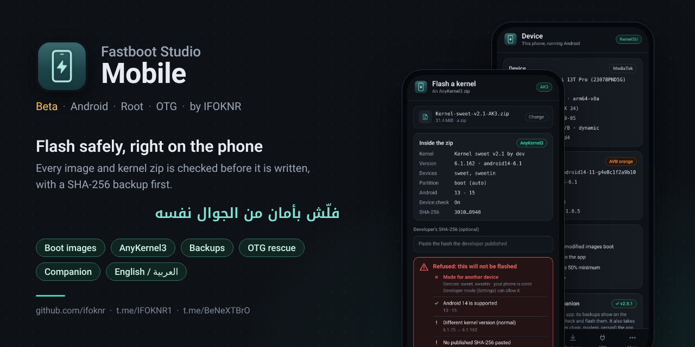
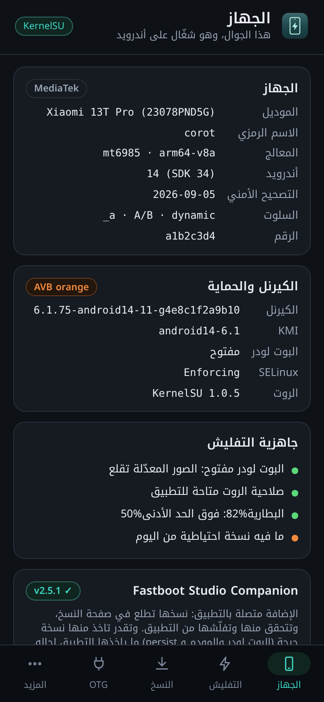
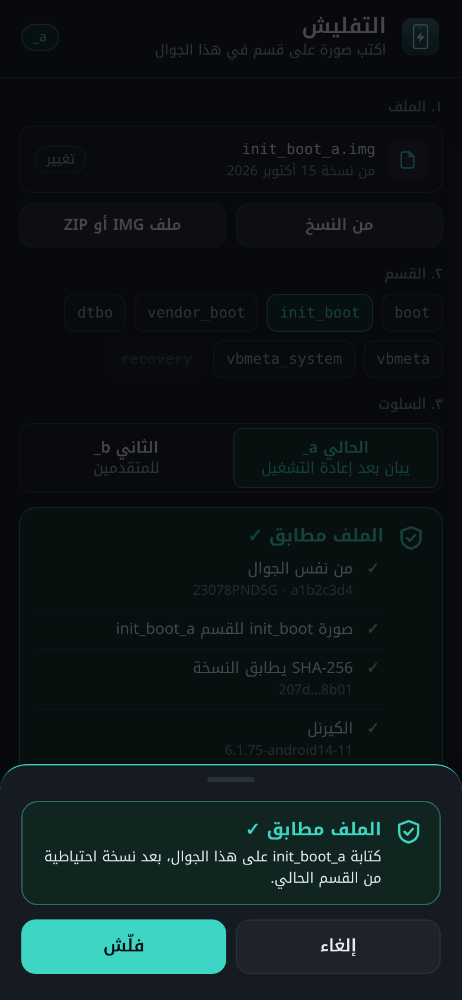
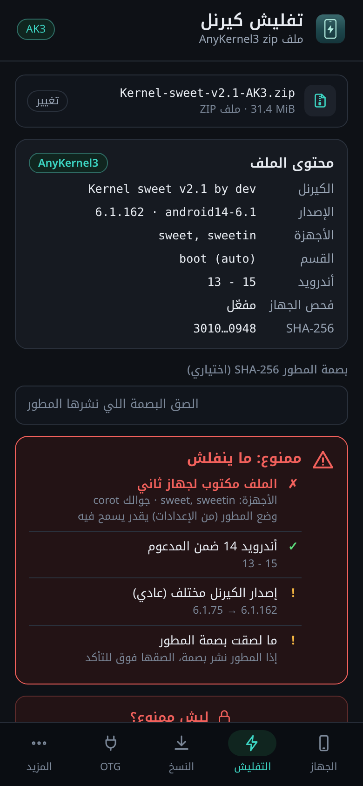
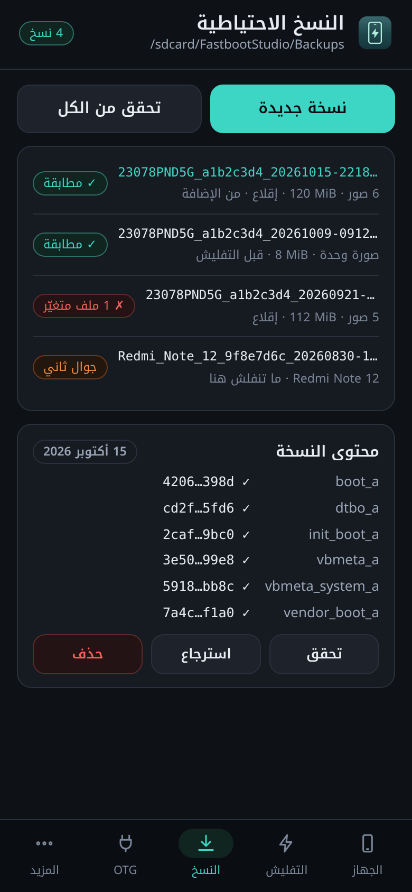
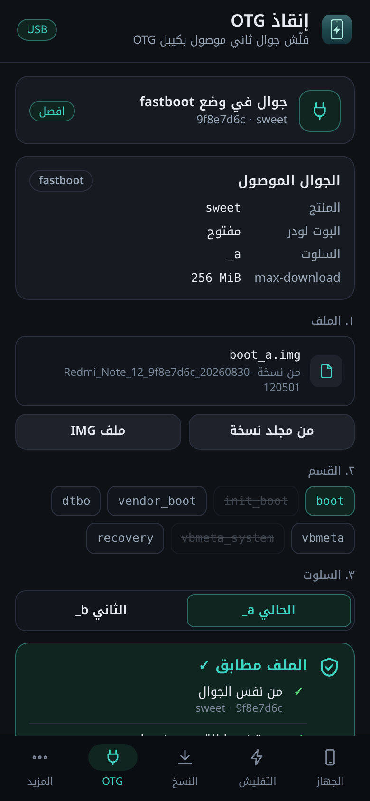

<p align="center">
  
</p>

<div dir="rtl">

<p align="center">
  <b>صور الإقلاع، ملفات AnyKernel3، نسخ احتياطية ببصمة SHA-256، وإنقاذ جوال ثاني بالـ OTG — وكل ملف ينفحص قبل ما ينكتب.</b><br>
  <a href="README.md">English</a> · <a href="#تثبيت">التثبيت</a> · <a href="#الصفحات">الصفحات</a> · <a href="#الفحص">كيف ينفحص الملف</a> · <a href="CHANGELOG.md">الجديد</a> · <a href="#مساعدة">المساعدة</a>
</p>

</div>

<p align="center">
  
  
  
  <a href="https://github.com/ifoknr/FastbootStudio-Mobile/releases"></a>
  
  
  <a href="https://t.me/BeNeXTBrO"></a>
</p>

<div dir="rtl">

**Fastboot Studio Mobile** هو [Fastboot Studio](https://github.com/ifoknr/FastbootStudio) على الجوال نفسه.
فلّش صورة boot أو ملف كيرنل بدون كمبيوتر، رجّع نسخة احتياطية بضغطتين، أو أنقذ جوال ثاني بكيبل USB.
والتطبيق يفحص كل ملف قبل الكتابة: من أي جوال جاء، وش نوع الصورة، وش الكيرنل اللي فيه، وهل بصمة SHA-256 حقته لسا مطابقة.

> 🧪 **بيتا.** أول إصدار للعامة. انجرّب على جوالات حقيقية، لكن خلّ عندك نسخة احتياطية و[بلّغنا](#مساعدة) عن أي شي غريب.
> نسخة البيتا يوصلها البيتا الجاي والإصدار الرسمي كتحديث.

<a id="تثبيت"></a>
## التثبيت

1. حمّل `FastbootStudio-Mobile-vX.Y.Z.apk` من [الإصدارات](https://github.com/ifoknr/FastbootStudio-Mobile/releases)
   (البيتا تحت *Pre-release*). بصمة SHA-256 موجودة في ملاحظات الإصدار وفي `SHA256SUMS`.
2. ثبّته. أندرويد يطلب مرة وحدة تسمح بالتثبيت من المتصفح أو مدير الملفات.
3. افتحه. لو عندك روت (Magisk أو KernelSU أو APatch)، وافق لما يطلب مدير الروت الصلاحية؛ هي اللي تخلي التطبيق يقرا ويكتب الأقسام والنسخ الاحتياطية.
   بدون روت تشتغل صفحة الجهاز والـ OTG.

يحتاج أندرويد 8 أو أحدث، معالج arm64 أو arm. في الإعدادات خيار *التحقق من التحديثات* (مرة باليوم، أو يدوي).

<a id="الصفحات"></a>
## الصفحات

### 📱 الجهاز
الموديل، المعالج، نسخة أندرويد وتحديث الحماية، السلوت ونوع الأقسام، الكيرنل والـ KMI، البوت لودر و SELinux، الروت، البطارية، وقائمة *جاهز للتفليش*.
ولو إضافة [Companion](https://github.com/ifoknr/FastbootStudio-Companion) مركّبة، ياخذ لك منها نسخ احتياطية للأقسام المهمة أو كاملة.

### ⚡ التفليش
اختر صورة من نسخك الاحتياطية أو أي ملف `.img` / `.zip`، والقسم (boot و init_boot و vendor_boot و dtbo و vbmeta و vbmeta_system و recovery)، والسلوت.
الفحص يشتغل على طول ويقولك بكلام واضح وش لقى. كل تفليش يسألك قبل، وياخذ نسخة من القسم الحالي قبل ما يكتب عليه.

### 🧩 الكيرنلات (AnyKernel3)
يقرا الملف قبل ما يشغّله: نسخة الكيرنل والـ KMI اللي فيه، الأجهزة المسوّى لها، نسخ أندرويد المدعومة، وكل سكربت داخله.
كيرنل من سلسلة ثانية (5.10 على جوال 6.1) أو سكربت يلمس شي الكيرنل ما يحتاجه، ينرفض.

### 💾 النسخ الاحتياطية
نفس مجلدات برنامج الويندوز والـ Companion (`/sdcard/FastbootStudio/Backups`)، مع ملف `SHA256SUMS`.
افحصها كلها بضغطة، افتح وحدة، ورجّع منها أي قسم. التطبيق يحتفظ بسجل خاص فيه بصمات كل نسخة، فلو أحد بدّل ملف بعدين ينكشف.

### 🔌 OTG
وصّل جوال ثاني وهو في وضع fastboot بكيبل OTG: التطبيق يقرا أقسامه ويفلّش المسموح منها، على ذاك الجوال بس وبرقمه التسلسلي. ما يحتاج روت في أي جوال.

### ⚙️ المزيد
الإعدادات (المظهر، اللغة، نسخة قبل التفليش، التحقق بعد الكتابة، أقل نسبة بطارية، وضع المطوّر، التحديثات)، السجل، وحول التطبيق.

</div>

<p align="center">
  
  
  
  
  
</p>

<div dir="rtl">

<a id="الفحص"></a>
## كيف ينفحص الملف

| المستوى | متى | وش يصير |
| --- | --- | --- |
| ✅ سليم | نسخة من نفس الجوال وبصمتها مطابقة | يفلّش بعد ما توافق |
| 🟡 ملاحظة | نسخة كيرنل ثانية من نفس السلسلة، تحديث حماية أقدم، ما لصقت البصمة المنشورة | تكمل أو تلغي |
| 🟠 تحذير | ملف من برا النسخ الاحتياطية، ملف zip فحص الجهاز فيه مقفول | تكتب اسم القسم |
| 🔴 مرفوض | ملف تالف أو متلاعب فيه أو مضر، نسخة جوال ثاني، صورة أو قسم غلط، سلسلة كيرنل ثانية | ما ينفلش أبداً |

مثبّت AnyKernel3 يشتغل بصلاحية روت، فكل سكربت في الملف ينقرا قبل. الملف ينرفض لو سكربتاته تكتب على قسم الكيرنل ما يحتاجه
(modem و persist وسلسلة البوت لودر و userdata…)، أو تفرمت أو تمسح التخزين، أو تحذف بياناتك، أو تستخدم الإنترنت، أو تشغّل ملف ما ينقرا.
هذا يكشف اللي يسويه الملف المضر بشكل واضح، لكنه ما يقدر يثبت إن الملف آمن، عشان كذا التطبيق ياخذ نسخة احتياطية قبل، وتقدر تلصق بصمة المطوّر.

**وضع المطوّر** (في الإعدادات) يحوّل بس "مسوّى لجهاز ثاني أو نسخة أندرويد أو كيرنل ثانية" إلى تحذير. الملفات التالفة أو المتلاعب فيها أو المضرة تبقى مرفوضة.

الأقسام اللي ممكن تقفل الجوال (سلسلة البوت لودر، modem، persist…) ما تنكتب من الجوال أبداً؛ لها استخدم [Fastboot Studio للويندوز](https://github.com/ifoknr/FastbootStudio).

## مع باقي الأدوات

- **[Fastboot Studio](https://github.com/ifoknr/FastbootStudio)** (ويندوز): تحديثات OTA كاملة، صور super، مستخرج payload، وكل شي في fastboot. البرنامجين يستخدمون نفس مجلدات النسخ الاحتياطية.
- **[Fastboot Studio Companion](https://github.com/ifoknr/FastbootStudio-Companion)** (إضافة روت): التطبيق يلقاها بنفسه لو مركّبة، ونسخها تطلع في صفحة النسخ الاحتياطية.

<a id="مساعدة"></a>
## المساعدة والأخبار

- قروب تيليجرام: [t.me/BeNeXTBrO](https://t.me/BeNeXTBrO)
- رسالة خاصة: [t.me/IFOKNR1](https://t.me/IFOKNR1)
- الأخطاء والأفكار: [Issues](https://github.com/ifoknr/FastbootStudio-Mobile/issues). السجل (المزيد › السجل) يساعد؛ انسخه في البلاغ أو ارفقه كملف `.txt`.

## للمطوّرين

</div>

```
dotnet test tests/FastbootStudio.Mobile.Core.Tests        # the safety core, any OS
dotnet workload install android
dotnet build src/FastbootStudio.Mobile -c Release \
  -p:AndroidSdkDirectory=... -p:JavaSdkDirectory=...       # the APK
```

<div dir="rtl">

الـ CI يبني APK تجريبي مع كل تعديل (`FastbootStudio-Mobile-test-apk`)، والإصدارات تنبني وتنوقّع من `.github/workflows/release.yml`.
والصفحات لحالها تنفتح في المتصفح: `src/FastbootStudio.Mobile/ui/index.html`، و `demo.js` يمثّل الجوال (`?lang=ar&theme=light&root=0&dev=1&otg=1`)؛ وما ينضاف للـ APK.

---

## الحقوق

- تطوير وصيانة **IFOKNR** — تيليجرام [@IFOKNR1](https://t.me/IFOKNR1) · GitHub [ifoknr](https://github.com/ifoknr)
- مبني على مكتبة Fastboot Studio Core (`external/FastbootStudio`)، المبنية على [Fastboot Enhance](https://github.com/libxzr/FastbootEnhance) للمطوّر LibXZR
- الخطوط: Roboto و Noto Kufi Arabic (رخصة SIL Open Font)

منشور برخصة [MIT](LICENSE).

</div>
