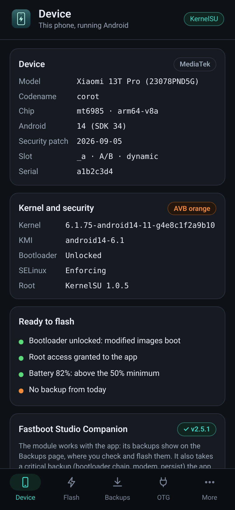
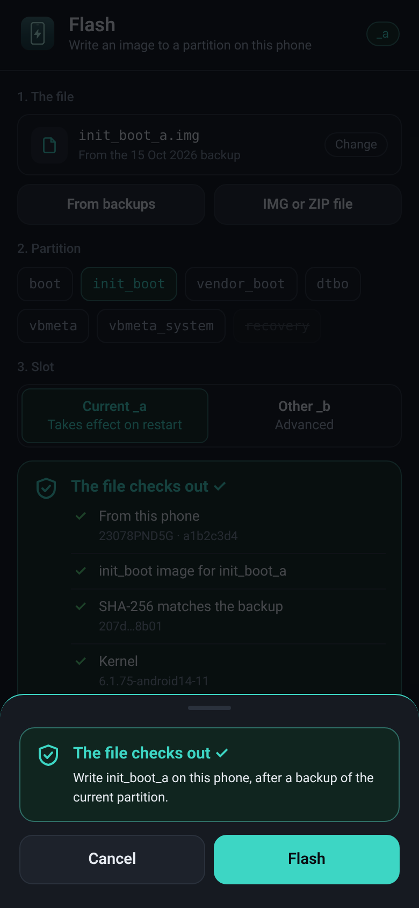
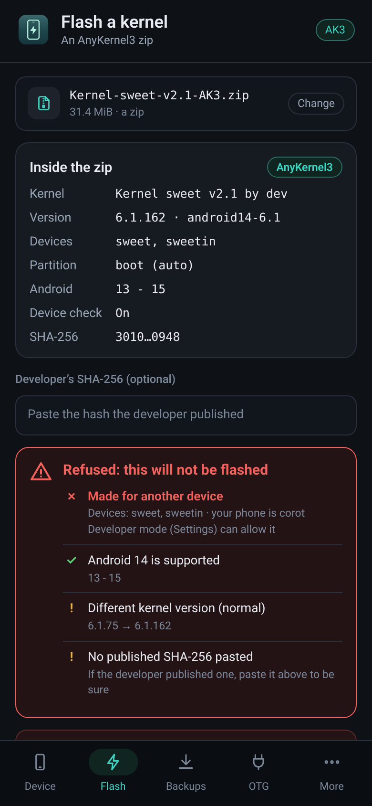
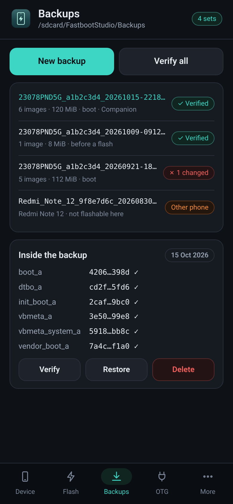
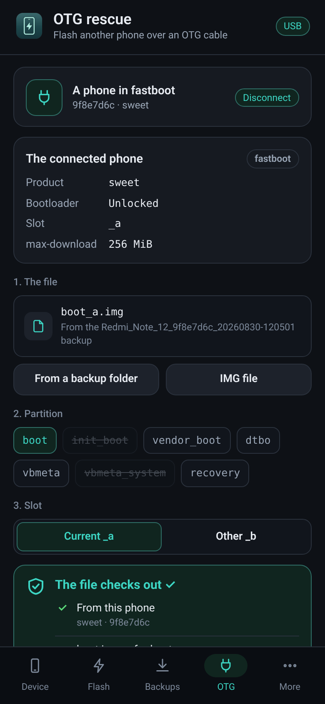

<p align="center">
  
</p>

<p align="center">
  <b>Boot images, AnyKernel3 zips, SHA-256 backups and OTG rescue — checked before anything is written.</b><br>
  <a href="README.ar.md">العربية</a> · <a href="#install">Install</a> · <a href="#pages">Pages</a> · <a href="#safety">Safety</a> · <a href="CHANGELOG.md">What's new</a> · <a href="#help">Help</a>
</p>

<p align="center">
  
  
  
  <a href="https://github.com/ifoknr/FastbootStudio-Mobile/releases"></a>
  
  
  <a href="https://t.me/BeNeXTBrO"></a>
</p>

**Fastboot Studio Mobile** brings [Fastboot Studio](https://github.com/ifoknr/FastbootStudio) to
the phone itself. Flash a boot image or a kernel zip without a computer, restore a backup in
two taps, or rescue another phone over a USB cable, and let the app check every file first:
which phone it came from, what kind of image it is, which kernel it carries and whether its
SHA-256 still matches.

> 🧪 **Beta.** The first public version. It has been tested on real phones, but please keep a
> backup and [tell us](#help) about anything that looks wrong. A beta gets the next betas and
> the stable release as updates.

<a id="install"></a>
## Install

1. Download `FastbootStudio-Mobile-vX.Y.Z.apk` from [Releases](https://github.com/ifoknr/FastbootStudio-Mobile/releases)
   (betas are under *Pre-release*). Its SHA-256 is in the release notes and in `SHA256SUMS`.
2. Install it. Android asks to allow installs from your browser or file manager once.
3. Open it. With root (Magisk, KernelSU or APatch), grant access when the root manager asks;
   that is what lets the app read and write partitions and backups. Without root, the
   Device page and OTG still work.

Android 8 or newer, arm64 or arm. Settings has *Check for updates* (once a day, or by hand).

<a id="pages"></a>
## The pages

<table>
<tr>
<td width="50%" valign="top">

### 📱 Device
Model, chip, Android and security patch, slot and layout, the kernel and its KMI, bootloader
and SELinux, root, battery, and a *Ready to flash* list. With the
[Companion](https://github.com/ifoknr/FastbootStudio-Companion) module installed it takes
critical and full backups for you.

### ⚡ Flash
Pick an image from your backups or any `.img` / `.zip`, the partition (boot, init_boot,
vendor_boot, dtbo, vbmeta, vbmeta_system, recovery) and the slot. The check runs at once and
says in plain words what it found. Every flash asks first, and the current partition is backed
up before it is written.

### 🧩 Kernels (AnyKernel3)
Reads the zip before it runs: the kernel version and KMI inside, the devices it is made for,
the Android range, and every script in it. A kernel from another series (5.10 on a 6.1 phone)
or a script that touches what a kernel never needs is refused.

</td>
<td width="50%" valign="top">

### 💾 Backups
The same folders as the Windows app and the Companion (`/sdcard/FastbootStudio/Backups`), with
`SHA256SUMS`. Check them all in one tap, open one, restore a partition from it. The app keeps
its own private record of each backup's hashes, so a file swapped later is caught.

### 🔌 OTG
Connect another phone in fastboot mode with a USB OTG cable: the app reads its partitions and
flashes the allowed ones, to that phone only, by its serial. No root needed on either phone.

### ⚙️ More
Settings (theme, language, backup before flashing, read-back check, minimum battery, developer
mode, updates), the log, and About.

</td>
</tr>
</table>

<p align="center">
  
  
  
  
  
</p>

<a id="safety"></a>
## How a file is checked

| Level | When | What happens |
| --- | --- | --- |
| ✅ Ok | This phone's backup and its SHA-256 matches | Flash, after you confirm |
| 🟡 Notice | Another kernel version in the same series, an older patch level, no published hash pasted | Continue or Cancel |
| 🟠 Warn | A file from outside the backups, a zip with its device check off | Type the partition name |
| 🔴 Block | Damaged, tampered or harmful; another phone's backup; the wrong image or partition; another kernel series | Never flashed |

An AnyKernel3 installer runs as root, so every script in the zip is read first. A zip whose
scripts write a partition no kernel needs (modem, persist, the bootloader chain, userdata…),
format or wipe storage, delete your data, use the network, or run a file that cannot be read,
is blocked. That catches what a harmful zip plainly does; it cannot prove a zip is safe, which
is why the backup is taken first and the developer's SHA-256 can be pasted.

**Developer mode** (Settings) turns only "made for another device, Android version or kernel"
into a Warn. Damaged, tampered or harmful files stay blocked.

The partitions that can brick a phone (the bootloader chain, modem, persist…) are never
written from the phone; use [Fastboot Studio for Windows](https://github.com/ifoknr/FastbootStudio)
for those.

## With the other tools

- **[Fastboot Studio](https://github.com/ifoknr/FastbootStudio)** (Windows): full OTAs, super
  images, payload dumper and everything in fastboot. Both apps use the same backup folders.
- **[Fastboot Studio Companion](https://github.com/ifoknr/FastbootStudio-Companion)** (root module):
  found by itself when installed; its backups show on the Backups page.

<a id="help"></a>
## Help and news

- Telegram group: [t.me/BeNeXTBrO](https://t.me/BeNeXTBrO)
- Private message: [t.me/IFOKNR1](https://t.me/IFOKNR1)
- Bugs and ideas: [Issues](https://github.com/ifoknr/FastbootStudio-Mobile/issues). The log
  (More › Logs) helps; copy it into the issue or attach it as a `.txt`.

## For developers

```
dotnet test tests/FastbootStudio.Mobile.Core.Tests        # the safety core, any OS
dotnet workload install android
dotnet build src/FastbootStudio.Mobile -c Release \
  -p:AndroidSdkDirectory=... -p:JavaSdkDirectory=...       # the APK
```

CI builds a test APK on every push (the `FastbootStudio-Mobile-test-apk` artifact); releases
are built and signed by `.github/workflows/release.yml`. The pages alone open in a browser:
`src/FastbootStudio.Mobile/ui/index.html`, where `demo.js` stands in for the phone
(`?lang=ar&theme=light&root=0&dev=1&otg=1`); it is not packed into the APK.

---

## Credits

- Developed and maintained by **IFOKNR** — Telegram [@IFOKNR1](https://t.me/IFOKNR1) · GitHub [ifoknr](https://github.com/ifoknr)
- Built on the Fastboot Studio Core library (`external/FastbootStudio`), which is based on
  [Fastboot Enhance](https://github.com/libxzr/FastbootEnhance) by LibXZR
- Fonts: Roboto and Noto Kufi Arabic (SIL Open Font License)

Released under the [MIT License](LICENSE).
